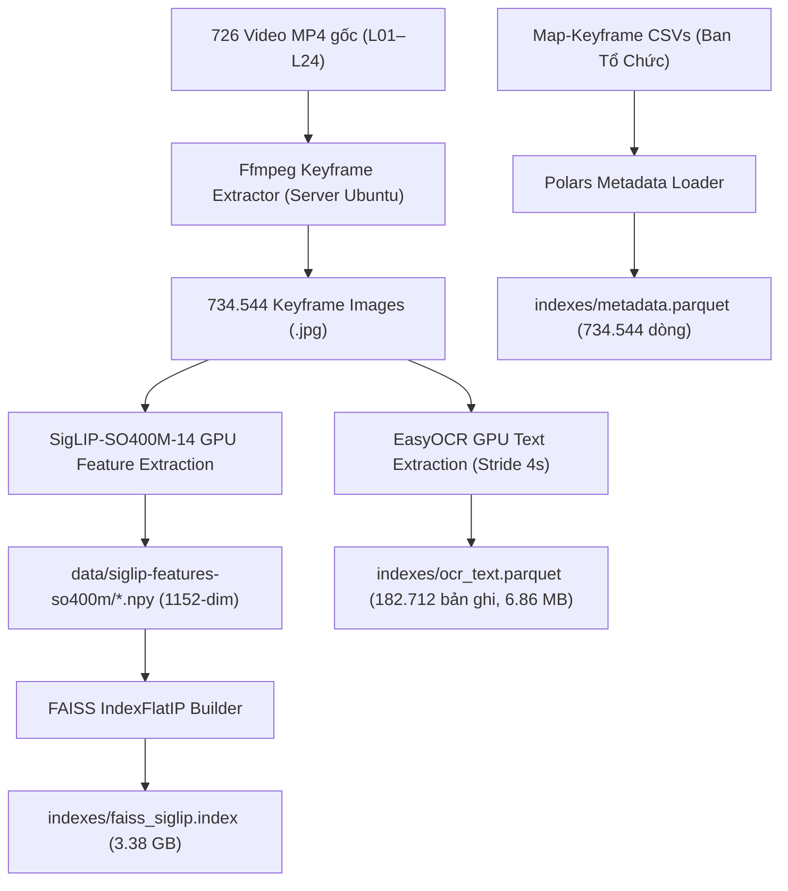
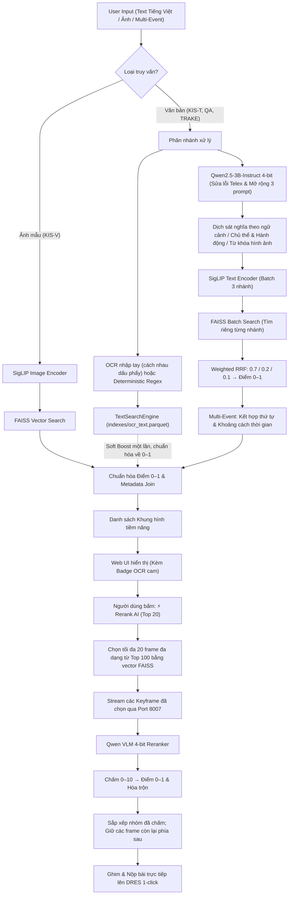

  # AIC-HCMC 2026 — Hệ thống Truy vấn Video & Hỗ trợ Thi đấu

Hệ thống tìm kiếm khung hình video (Video Keyframe Retrieval) đa phương thức phục vụ cuộc thi **AI Challenge TP.HCM 2026 (AIC-HCMC-26)**. Hệ thống được tối ưu hóa đặc biệt để chạy trực tiếp trên GPU kết hợp với server lưu trữ dữ liệu.

---

## 1. Giới thiệu dự án & Các Task thi đấu hỗ trợ

Hệ thống được thiết kế toàn diện để giải quyết trọn vẹn cả 4 bài toán cốt lõi trong thể lệ cuộc thi:

### 1.1. KIS-T (Textual Known-Item Search)
- **Mô tả:** Ban giám khảo cung cấp một đoạn mô tả chi tiết bằng ngôn ngữ tự nhiên (tiếng Việt hoặc tiếng Anh) về một sự kiện, nhân vật, hoặc bối cảnh trong video.
- **Yêu cầu:** Đội thi cần định vị đúng video và chỉ định **duy nhất 1 khung hình** (`frame_id`) thuộc đoạn diễn ra sự kiện đó.
- **Định dạng kết quả nộp:**
  ```text
  <video_id>, <frame_id>
  ```
  *(Ví dụ: `L01_V001, 505`)*
- **Cơ chế xử lý:** Hệ thống tự động sửa lỗi chính tả tiếng Việt qua SLM, dịch và phân tách thành các góc nhìn (bối cảnh, hành động, từ khóa), kết hợp với tra cứu văn bản OCR để đưa khung hình chính xác lên Top 1.

### 1.2. KIS-V (Visual Known-Item Search)
- **Mô tả:** Ban giám khảo cung cấp 1 hình ảnh truy vấn (ảnh mẫu cắt từ đoạn video mẫu 5 giây của đề bài).
- **Yêu cầu:** Tìm lại đúng phân cảnh và khung hình gốc trong kho dữ liệu gồm 726 video (`L01`–`L24`).
- **Định dạng kết quả nộp:**
  ```text
  <video_id>, <frame_id>
  ```
- **Cơ chế xử lý:** Thí sinh kéo thả ảnh hoặc chụp màn hình (`Win + Shift + S`) dán vào ô tìm kiếm, hoặc bấm nút **`⚡ Tương đồng`** ngay trên bất kỳ keyframe nào. Hệ thống trích xuất vector bằng SigLIP Vision Encoder và đối soát Cosine Similarity qua FAISS FlatIP, trả về frame gốc ở Top 1 với độ tin cậy $> 0.85$.

### 1.3. KIS-QA (Video Question Answering)
- **Mô tả:** Ban giám khảo cung cấp một mô tả sự kiện kèm theo một câu hỏi cụ thể cần trích xuất thông tin (ví dụ: *"Người mặc áo xanh cầm vật gì trên tay?", "Có bao nhiêu xe máy đang dừng đèn đỏ?"*).
- **Yêu cầu:** Xác định đúng video, khung hình chứa đáp án và câu trả lời dạng chữ hoặc số.
- **Định dạng kết quả nộp:**
  ```text
  QA-<ANSWER>-<VIDEO_ID>-<TIME_MS>
  ```
  *(Ví dụ: `QA-5-L05_V005-35520`)*
- **Cơ chế xử lý:** Thí sinh tìm phân cảnh liên quan $\to$ bấm **`📌 Ghim`** vào khu vực Export $\to$ nhập câu trả lời vào ô text trên card. Web UI tự động quy đổi `pts_time` thành miligiây và định dạng chuỗi nộp chuẩn DRES.

### 1.4. TRAKE (Temporal Retrieval and Alignment of Key Events)
- **Mô tả:** Đề bài yêu cầu tìm một chuỗi các sự kiện tuần tự có cấu trúc diễn ra bên trong cùng một video (ví dụ: chuỗi 4 giai đoạn của môn Nhảy cao: *1. Chạy đà $\to$ 2. Giậm nhảy $\to$ 3. Bay qua xà $\to$ 4. Tiếp đất*).
- **Yêu cầu:** 
  1. *Retrieval:* Xác định đúng duy nhất video chứa toàn bộ chuỗi sự kiện.
  2. *Alignment:* Chọn đúng các semantic keyframes tương ứng cho từng sự kiện theo trật tự thời gian tăng dần ($\text{frame}_1 < \text{frame}_2 < \dots < \text{frame}_n$).
- **Định dạng kết quả nộp:**
  ```text
  TR-<VIDEO_ID>-<FRAME_ID_1>-<FRAME_ID_2>-...-<FRAME_ID_N>
  ```
  *(Ví dụ: `TR-L10_V010-101-150-203-251`)*
- **Cơ chế xử lý:** Tính năng Multi-Event trên Web UI cho phép thêm các sự kiện con (`Event 1 -> Event 2`), tự động boost điểm các video thỏa mãn điều kiện thời gian và hỗ trợ ghim nhanh chuỗi frame theo đúng thứ tự.

---

## 2. Kiến trúc Pipelines (Kiến trúc hệ thống chi tiết)

### 2.1. Offline Pipeline (Tiền xử lý & Xây dựng Index)

Quy trình tiền xử lý ngoại tuyến chuyển đổi video thô thành các cơ sở dữ liệu chỉ mục tốc độ cao:



- **SigLIP-SO400M Index:** Vector 1152 chiều chuẩn hóa $L_2$, nạp trực tiếp vào CPU RAM qua FAISS `IndexFlatIP` cho tốc độ truy vấn $< 30\text{ ms}$.
- **OCR Text Database:** Trích xuất biển số, chữ số, tên thương hiệu bằng EasyOCR subsampled, lưu dạng bảng nén Parquet nạp trong $< 50\text{ ms}$.
- **Master Metadata:** Ánh xạ tức thời giữa `video_id`, `keyframe_name`, `pts_time` và `frame_id` gốc để nộp bài.

---

### 2.2. Online Pipeline (Truy vấn thời gian thực & Reranking)

Quy trình xử lý một câu truy vấn trực tiếp từ người dùng đến khi ra kết quả cuối cùng:



---

- **Multi-Query Retrieval:** SLM sinh 3 nhánh trong một lượt; nhánh chính dịch theo ngữ cảnh. SigLIP encode và FAISS tìm theo batch, gộp Weighted RRF với trọng số **0.7 / 0.2 / 0.1** (`k = 60`).
- **OCR Soft Boost:** Nhập `115, ambulance` để khớp bất kỳ cụm nào; để trống dùng Regex. Chỉ cộng điểm một lần cho frame đã có trong kết quả; với Multi-Event, OCR áp dụng cho ảnh sự kiện đầu tiên.
- **Điểm thống nhất 0–1:** Chuẩn hóa RRF, cosine và điểm Multi-Event trước khi kết hợp. Khi dùng OCR: `S = (điểm nền + 0.35 × khớp) / 1.35`; VLM: `0.35 × S + 0.65 × (điểm VLM / 10)`.
- **Frame đa dạng:** Nút Rerank chọn tối đa **20 frame từ Top 100**; bỏ qua frame cùng video khi vừa gần **≤ 3 giây**, vừa giống **cosine ≥ 0.97**; khác cảnh hoặc cách xa vẫn được giữ.
- **VLM Reranking:** Chỉ tải/chấm ảnh đã chọn, giữ thang **0–10**. Frame không được chọn vẫn nằm phía sau.

---

## 3. Hướng dẫn Cài đặt & Vận hành chi tiết (Step-by-Step)

Quy trình cài đặt môi trường lần đầu và khởi động hệ thống hàng ngày.

### Bước 3.1: Tạo Môi trường ảo & Cài đặt Thư viện (Làm 1 lần đầu trên CMD)
Mở cửa sổ **Command Prompt (CMD)** tại máy bạn và chọn một trong hai cách dưới đây:

- **Cách 1: Sử dụng Conda**:
  ```cmd
  # 1. Tạo môi trường ảo Conda với Python 3.10
  conda create -n aic26 python=3.10 -y

  # 2. Kích hoạt môi trường
  conda activate aic26

  # 3. Cài đặt PyTorch hỗ trợ GPU CUDA 12.1
  pip install torch torchvision --index-url https://download.pytorch.org/whl/cu121

  # 4. Cài đặt toàn bộ thư viện cần thiết từ requirements.txt
  pip install -r requirements.txt
  ```

- **Cách 2: Sử dụng UV**:
  ```cmd
  cd /d d:\STUDY\BIN\CS\PROJECT\AIC-HCMC-26

  # 1. Tạo môi trường ảo với Python 3.10 bằng uv
  uv venv aic26 --python 3.10

  # 2. Kích hoạt môi trường trên CMD
  aic26\Scripts\activate.bat

  # 3. Cài đặt PyTorch hỗ trợ GPU CUDA 12.1 và toàn bộ thư viện
  uv pip install torch torchvision --index-url https://download.pytorch.org/whl/cu121
  uv pip install -r requirements.txt
  ```

---

### Bước 3.2: Tải các file Database & Chỉ mục (Indexes)
Tải bộ file chỉ mục đã được tính toán sẵn và đặt vào đúng thư mục `indexes/` của dự án:
- 📥 **[Link Google Drive tải bộ file Index](https://drive.google.com/drive/folders/1roZhd76r0iNzGUe8PjyssyH-Yd0FGrUF?usp=sharing)**
- **Các file bắt buộc phải có trong thư mục `indexes/`:**
  1. `indexes/faiss_siglip.index` (Chỉ mục vector 1152 chiều, dung lượng ~3.38 GB)
  2. `indexes/metadata.parquet` (Bảng thông tin ánh xạ 734.544 keyframe, ~10 MB)
  3. `indexes/ocr_text.parquet` (Dữ liệu văn bản OCR toàn bộ video, ~6.86 MB)

---

### Bước 3.3: Cài đặt & Cấu hình OpenVPN Connect
Để truy cập vào hệ thống server nội bộ và máy chấm thi DRES của trường:

1. **Tải phần mềm OpenVPN Connect:**
   - 📥 **[Link tải OpenVPN Connect cho Windows](https://openvpn.net/client/client-connect-vpn-for-windows/)**
   - Tiến hành cài đặt file `.msi` theo hướng dẫn mặc định.
2. **Lấy file cấu hình `.ovpn`:**
   - 📥 **[Link Google Drive tải file .ovpn](https://drive.google.com/drive/folders/1ReOQRV_SPaSpSyttY2eZ1197tKyoxOhT?usp=sharing)**
3. **Kết nối trong ứng dụng OpenVPN Connect:**
   - Mở ứng dụng **OpenVPN Connect**.
   - Chuyển sang tab **FILE** $\to$ kéo thả file `pfSense4-UDP4-1195-config.ovpn` vào cửa sổ (hoặc bấm Browse).
   - Nhập **Username** và **Password** tài khoản VPN trường cấp.
   - Bấm nút gạt **Connect**. Khi trạng thái chuyển sang màu xanh lá cây (**CONNECTED**) là đã kết nối mạng nội bộ thành công.

---

### Bước 3.4: Mở kết nối SSH Tunnel tải ảnh Keyframe (PowerShell)
Mở một cửa sổ **PowerShell** trên máy bạn và chạy lệnh sau để dẫn luồng ảnh từ Server Ubuntu (`192.168.28.112:8007`) về máy `localhost:8007`:

```powershell
ssh -N -L 8007:localhost:8007 team12@192.168.28.112
```
- Nhập password server: `123456`
- **Lưu ý:** *Giữ nguyên cửa sổ PowerShell này chạy ngầm trong suốt quá trình làm việc.*

---

### Bước 3.5: Khởi động Hệ thống & Mở Web UI (Chỉ duy nhất 1 lệnh trên CMD)
Server backend đã được tích hợp sẵn toàn bộ API, nạp các mô hình AI và **tự động mount toàn bộ giao diện Web UI**. Bạn chỉ cần mở **duy nhất 1 cửa sổ CMD**:

```cmd
cd /d d:\STUDY\BIN\CS\PROJECT\AIC-HCMC-26

# Kích hoạt môi trường (chọn 1 trong 2):
conda activate aic26
# HOẶC nếu dùng uv: aic26\Scripts\activate.bat

# Chạy server (mặc định dùng SLM Qwen2.5-3B và VLM Qwen2.5-VL-3B):
python src/server.py --port 8006

# Tùy chọn đổi SLM sang 4B:
python src/server.py --port 8006 --llm 4b

# Tùy chọn cấu hình cả SLM và VLM (3b / 2b / 7b):
python src/server.py --port 8006 --llm 3b --vlm 2b
```

👉 Sau khi terminal hiện `Uvicorn running on http://0.0.0.0:8006`, mở trình duyệt web truy cập ngay địa chỉ: **`http://localhost:8006`** để bắt đầu thi đấu!

---

### Bước 3.6: Các Website nộp bài thi (Submission Portals)

Hệ thống hỗ trợ nộp bài tự động qua API DRES hoặc xuất kết quả thủ công lên cổng thi đấu:

| Cổng chấm thi | Đường dẫn truy cập | Ghi chú |
|---|---|---|
| **UIT Contest DRES (Chính thức)** | [https://aiclub.uit.edu.vn/dres](https://aiclub.uit.edu.vn/dres) | Cổng chấm thi chính thức của BTC |

- **Tài khoản nhóm:** team12_t5 - 123456
- **Cách nộp trên Web UI:**
  1. Ghim các frame kết quả vào khu vực **Export Area** ở cạnh phải màn hình.
  2. Bấm nút **`🚀 Submit DRES`** ở góc trên thanh công cụ.
  3. Hệ thống sẽ tự động gửi request đến máy chấm và thông báo kết quả trả về ngay trên màn hình.

---

## 4. Danh sách Mô hình sử dụng & Cấu trúc Mã nguồn

### 4.1. Danh mục Mô hình Trí tuệ Nhân tạo (Model Zoo)

| Mô hình | Trọng số / Checkpoint | Chế độ chạy | VRAM tiêu thụ | Vai trò trong hệ thống & Tùy chọn CLI |
|---|---|---|---|---|
| **Google SigLIP** | `ViT-SO400M-14-SigLIP` (webli) | FP16 trên GPU | ~1.5 GB | Trích xuất đặc trưng hình ảnh và văn bản đa ngôn ngữ (1152-dim). |
| **Qwen2.5-3B** *(Mặc định)* | `Qwen/Qwen2.5-3B-Instruct` | 4-bit (`nf4` BnB) | ~2.05 GB | SLM Mở rộng query SOTA chuẩn xác (< 0.2s trên GPU). Bật bằng: `--llm 3b`. |
| **Qwen3-4B** *(Tùy chọn)* | `Qwen/Qwen3-4B` | 4-bit (`nf4` BnB) | ~2.5 GB | SLM Mở rộng query thay thế. Bật bằng: `--llm 4b`. |
| **Qwen2.5-VL-3B** *(Mặc định)* | `Qwen/Qwen2.5-VL-3B-Instruct` | 4-bit (`nf4` BnB) | ~2.1 GB | VLM Reranker Top-20 SOTA & KIS-QA (~0.8s). Bật bằng: `--vlm 3b`. |
| **Qwen2-VL-2B** *(Tùy chọn)* | `Qwen/Qwen2-VL-2B-Instruct` | 4-bit (`nf4` BnB) | ~1.5 GB | VLM Reranker siêu nhẹ cho máy tiết kiệm VRAM. Bật bằng: `--vlm 2b`. |
| **Qwen2-VL-7B** *(Tùy chọn)* | `Qwen/Qwen2-VL-7B-Instruct` | 4-bit (`nf4` BnB) | ~4.5 GB | VLM Reranker bản lớn (cần máy >12GB VRAM nếu chạy cùng SLM). Bật bằng: `--vlm 7b`. |
| **EasyOCR** | PyTorch Native (vi, en) | CUDA FP16 | ~1.2 GB *(Offline)* | Quét nhận diện chữ viết, biển số xe, số hiệu trên keyframe. |

#### Các tổ hợp mô hình đề xuất trên RTX 4060 (8 GB VRAM):
- **Cấu hình 1 (Mặc định - Cân bằng tối ưu):** `python src/server.py --port 8006 --llm 4b --vlm 3b` *(Tổng VRAM: ~6.6 GB / 8.0 GB)*
- **Cấu hình 2 (Nhanh & Nhẹ):** `python src/server.py --port 8006 --llm 3b --vlm 3b` *(Tổng VRAM: ~6.15 GB / 8.0 GB)*
- **Cấu hình 3 (Siêu tiết kiệm VRAM):** `python src/server.py --port 8006 --llm 3b --vlm 2b` *(Tổng VRAM: ~5.55 GB / 8.0 GB)*

### 4.2. Cấu trúc thư mục mã nguồn chính

```
AIC-HCMC-26/
├── src/
│   ├── config.py                         # Cấu hình tập trung đường dẫn, model, trọng số
│   ├── server.py                         # Backend FastAPI & WebSocket điều phối tìm kiếm
│   ├── online_pipeline/
│   │   ├── query_expander.py             # Sửa lỗi chính tả & mở rộng query (Qwen2.5-3B)
│   │   ├── query_encoder.py              # Mã hóa SigLIP Text/Image vector (1152-dim)
│   │   ├── retrieval.py                  # Công cụ truy xuất FAISS & kết hợp metadata Polars
│   │   ├── text_search.py                # Công cụ tìm kiếm OCR & trích xuất Regex cứng
│   │   ├── vlm_reranker.py               # Bộ chấm điểm thị giác sâu Top-20 (Qwen2-VL-7B)
│   │   └── temporal_search.py            # Xử lý chuỗi sự kiện thời gian
│   ├── offline_pipeline/
│   │   ├── metadata_loader.py            # Tạo file metadata.parquet từ CSV ban tổ chức
│   │   └── build_index.py                # Xây dựng chỉ mục faiss_siglip.index
│   ├── tasks/                            # Xử lý đặc thù: kis_t.py, vqa.py, trake.py
│   └── utils/translation.py              # Bộ dịch tiếng Việt dự phòng có bộ nhớ đệm LRU
├── baseline/retrievalBaseline/frontend/  # Giao diện thi đấu Web UI (HTML, CSS, JS)
│   ├── index.html                        # Giao diện chính Dark Theme
│   └── src/scripts/
│       ├── script.js                     # Xử lý tìm kiếm, giao tiếp WebSocket & REST
│       ├── update_result.js              # Hiển thị lưới ảnh, huy hiệu OCR và VLM
│       ├── export.js                     # Quản lý khu vực ghim (Export Area) & KIS-QA
│       ├── left_panel.js                 # Điều khiển thanh công cụ và nút Rerank AI
│       └── submit_dres.js                # Quản lý phiên DRES và nộp bài tự động
├── indexes/                              # Thư mục chứa các file Database cốt lõi
│   ├── faiss_siglip.index                # Chỉ mục FAISS 1152 chiều (3.38 GB)
│   ├── metadata.parquet                  # Bảng metadata 734.544 frames (10 MB)
│   └── ocr_text.parquet                  # Dữ liệu văn bản OCR (6.86 MB)
├── scripts/                              # Các kịch bản trích xuất đặc trưng & setup
│   ├── extract_siglip_features_gpu.py    # Trích xuất vector SigLIP trên GPU
│   └── extract_ocr_easyocr.py            # Trích xuất OCR bằng EasyOCR trên GPU
└── .opv/                                 # Chứa file cấu hình OpenVPN mạng trường (.ovpn)
```

---
